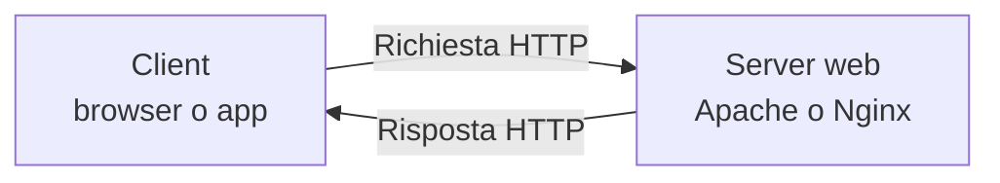
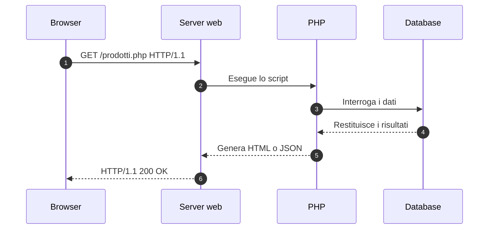
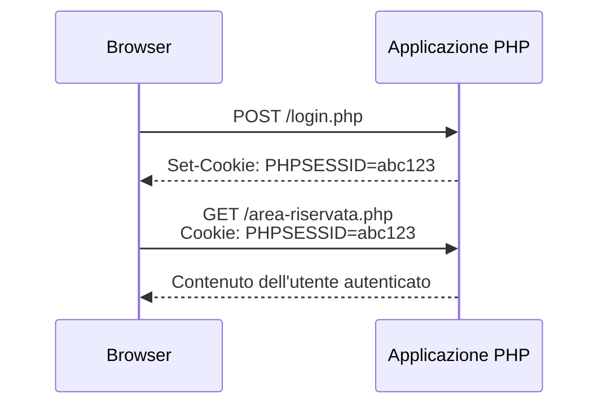
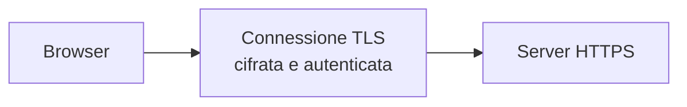

# Il protocollo HTTP

**HTTP**, Hypertext Transfer Protocol, è il protocollo applicativo usato per trasferire risorse sul Web.

- segue il modello **richiesta-risposta**;
- opera tra un client, come il browser, e un server web;
- trasferisce pagine HTML, immagini, file e dati JSON;
- non conserva automaticamente lo stato delle richieste precedenti.



| Protocollo | Porta predefinita | Protezione |
|---|---:|---|
| HTTP | 80 | Comunicazione non cifrata |
| HTTPS | 443 | HTTP protetto tramite TLS |

<!--
Note del docente:
HTTP appartiene al livello applicativo. TCP o QUIC gestiscono il trasporto nelle versioni oggi più diffuse del protocollo.
-->

---

# Struttura di un URL

Esempio:

```text
https://www.esempio.it:443/prodotti/dettaglio.php?id=25#recensioni
```

| Componente | Valore | Funzione |
|---|---|---|
| Schema | `https` | Indica il protocollo |
| Host | `www.esempio.it` | Identifica il server |
| Porta | `443` | Identifica il servizio di rete |
| Percorso | `/prodotti/dettaglio.php` | Indica la risorsa richiesta |
| Query string | `id=25` | Trasporta parametri al server |
| Frammento | `recensioni` | Indica una parte della pagina nel browser |

> Il browser non invia il frammento `#recensioni` al server nella richiesta HTTP.

<!--
Note del docente:
La porta può essere omessa quando coincide con quella predefinita del protocollo. La query string inizia con il carattere ?.
-->

---

# Scambio tra client e server



Il browser interpreta la risposta in base al tipo di contenuto indicato dal server.

Esempi:

- `text/html` per una pagina HTML;
- `application/json` per dati JSON;
- `image/png` per un'immagine PNG.

<!--
Note del docente:
HTTP gestisce lo scambio tra client e server web. La comunicazione interna con PHP e con il database può usare meccanismi e protocolli differenti.
-->

---

# Struttura di una richiesta HTTP

```http
GET /prodotti.php?categoria=notebook HTTP/1.1
Host: www.esempio.it
Accept: text/html
Accept-Language: it-IT
Cookie: PHPSESSID=a8f21c...

```

Una richiesta contiene:

1. **riga iniziale**, con metodo, risorsa e versione del protocollo;
2. **header**, che descrivono client, preferenze e contesto;
3. una **riga vuota**, che termina gli header;
4. un **corpo opzionale**, usato per inviare dati al server.

> Una richiesta `GET` normalmente non contiene un corpo. Una richiesta `POST` può contenerlo.

<!--
Note del docente:
La risorsa nella riga iniziale contiene il percorso e l'eventuale query string, non il nome completo del server. L'header Host specifica il dominio.
-->

---

# Metodi HTTP

Il metodo indica l'operazione richiesta al server.

| Metodo | Uso principale | Proprietà |
|---|---|---|
| `GET` | Leggere una risorsa | Sicuro e idempotente |
| `POST` | Inviare dati o avviare un'operazione | In genere non idempotente |
| `PUT` | Sostituire una risorsa identificata | Idempotente |
| `PATCH` | Modificare parte di una risorsa | Non sempre idempotente |
| `DELETE` | Eliminare una risorsa | Idempotente |
| `HEAD` | Ottenere gli header senza il corpo | Sicuro e idempotente |
| `OPTIONS` | Conoscere metodi e opzioni disponibili | Sicuro e idempotente |

**Idempotente** significa che ripetere la stessa richiesta produce lo stesso effetto finale previsto sul server.

<!--
Note del docente:
Sicuro significa che il metodo serve alla lettura e non dovrebbe modificare lo stato del server. L'idempotenza riguarda l'effetto previsto, non l'identicità della risposta.
-->

---

# Moduli HTML: GET e POST

## Invio con GET

```html
<form action="ricerca.php" method="get">
  <input name="q">
  <button>Cerca</button>
</form>
```

Il browser inserisce i dati nell'URL:

```text
/ricerca.php?q=php
```

## Invio con POST

```html
<form action="login.php" method="post">
  <input name="username">
  <input name="password" type="password">
  <button>Accedi</button>
</form>
```

Il browser inserisce i dati nel corpo della richiesta. **POST non cifra i dati**. Per proteggerli serve HTTPS.

<!--
Note del docente:
GET è adatto a ricerche e filtri condivisibili tramite URL. POST è adatto all'invio di dati che modificano lo stato o che non devono apparire nell'URL.
-->

---

# Struttura di una risposta HTTP

```http
HTTP/1.1 200 OK
Content-Type: application/json; charset=utf-8
Content-Length: 48
Cache-Control: no-store

{"id":25,"nome":"Notebook","prezzo":599.90}
```

Una risposta contiene:

1. **riga di stato**, con versione, codice e descrizione;
2. **header**, che descrivono contenuto e comportamento della risposta;
3. una **riga vuota**;
4. un **corpo opzionale**, con la rappresentazione della risorsa.

Il codice di stato permette al client di capire il risultato della richiesta prima di elaborare il corpo.

<!--
Note del docente:
Alcune risposte non includono un corpo. È il caso, per esempio, di una risposta 204 No Content o di una risposta a HEAD.
-->

---

# Codici di stato HTTP

| Classe | Significato | Esempi |
|---:|---|---|
| `1xx` | Informazione sullo scambio in corso | `100 Continue` |
| `2xx` | Richiesta completata con successo | `200 OK`, `201 Created`, `204 No Content` |
| `3xx` | Reindirizzamento o uso della cache | `301 Moved Permanently`, `304 Not Modified` |
| `4xx` | Errore nella richiesta del client | `400 Bad Request`, `401 Unauthorized`, `403 Forbidden`, `404 Not Found` |
| `5xx` | Errore durante l'elaborazione sul server | `500 Internal Server Error`, `503 Service Unavailable` |

## Distinzione utile

- `401 Unauthorized`: il client deve autenticarsi o fornire credenziali valide.
- `403 Forbidden`: il server riconosce la richiesta ma nega l'accesso.

<!--
Note del docente:
Non restituire sempre 200. Un'API deve usare un codice coerente con l'esito dell'operazione.
-->

---

# Header e tipi di contenuto

Gli header trasportano metadati relativi alla richiesta o alla risposta.

| Header | Direzione | Funzione |
|---|---|---|
| `Host` | Richiesta | Indica il dominio del server |
| `Accept` | Richiesta | Indica i formati accettati dal client |
| `Authorization` | Richiesta | Trasporta le credenziali previste dallo schema usato |
| `Content-Type` | Entrambe | Descrive il formato del corpo |
| `Content-Length` | Entrambe | Indica la dimensione del corpo in byte |
| `Location` | Risposta | Indica la destinazione di un reindirizzamento |
| `Cache-Control` | Entrambe | Definisce le regole di memorizzazione nella cache |
| `Set-Cookie` | Risposta | Chiede al browser di memorizzare un cookie |

Tipi MIME comuni: `text/html`, `text/css`, `application/json`, `application/pdf`, `image/jpeg`.

<!--
Note del docente:
Content-Type descrive il corpo effettivamente inviato. Accept esprime invece le preferenze del client per la risposta.
-->

---

# HTTP è un protocollo senza stato

Ogni richiesta HTTP è indipendente. Il server non associa automaticamente una nuova richiesta a quelle precedenti.



- Il **cookie** viene conservato dal browser e inviato nelle richieste successive.
- La **sessione PHP** conserva i dati sul server.
- Il cookie `PHPSESSID` contiene normalmente l'identificatore della sessione, non tutti i dati dell'utente.

> Cookie e sessioni aggiungono continuità applicativa a richieste HTTP indipendenti.

<!--
Note del docente:
Richiamare gli attributi di sicurezza dei cookie: Secure, HttpOnly e SameSite.
-->

---

# HTTP e HTTPS

HTTPS usa HTTP all'interno di una connessione protetta da **TLS**.



TLS svolge tre funzioni principali:

- **cifra** i dati scambiati, rendendoli illeggibili a chi intercetta il traffico;
- **verifica l'integrità** dei messaggi, rilevando modifiche durante il trasporto;
- **autentica il server** tramite un certificato digitale.

HTTPS non corregge vulnerabilità nel codice PHP. Restano necessari validazione, controllo degli accessi e gestione sicura delle sessioni.

<!--
Note del docente:
Il certificato associa una chiave pubblica all'identità dichiarata dal server. Il browser verifica la catena di certificazione e il nome del dominio.
-->

---

# Versioni del protocollo HTTP

Le versioni conservano gli stessi concetti applicativi: metodi, URL, header, codici di stato e contenuti.

| Versione | Trasporto | Caratteristiche principali |
|---|---|---|
| HTTP/1.0 | TCP | Connessioni semplici, spesso una per richiesta |
| HTTP/1.1 | TCP | Connessioni persistenti e header `Host` obbligatorio |
| HTTP/2 | TCP | Frame binari, compressione degli header e flussi multiplexati |
| HTTP/3 | QUIC su UDP | Multiplexing gestito da QUIC e connessioni più rapide da stabilire |

> Il codice PHP normalmente lavora con la stessa richiesta applicativa senza dipendere dalla versione HTTP negoziata dal client e dal server.

<!--
Note del docente:
HTTP/2 e HTTP/3 modificano il trasporto e la rappresentazione sul collegamento, ma non cambiano il significato di GET, POST, degli header o dei codici di stato.
-->

---

# Gestire HTTP con PHP

```php
<?php
header('Content-Type: application/json; charset=utf-8');

if ($_SERVER['REQUEST_METHOD'] !== 'GET') {
    http_response_code(405);
    header('Allow: GET');
    echo json_encode(['errore' => 'Metodo non consentito']);
    exit;
}

$id = filter_input(INPUT_GET, 'id', FILTER_VALIDATE_INT);

if ($id === false || $id === null) {
    http_response_code(400);
    echo json_encode(['errore' => 'ID non valido']);
    exit;
}

echo json_encode(['id' => $id, 'stato' => 'ok']);
```

PHP permette di leggere il metodo, recuperare i parametri, impostare gli header e scegliere il codice di stato della risposta.

<!--
Note del docente:
Confrontare $_GET, $_POST e il corpo JSON letto tramite php://input. Ricordare che i dati ricevuti devono sempre essere validati.
-->

---

# Verifica finale

Per la richiesta seguente:

```http
POST /api/utenti HTTP/1.1
Host: www.esempio.it
Content-Type: application/json

{"nome":"Anna","email":"anna@example.it"}
```

individua:

1. il metodo HTTP;
2. la risorsa richiesta;
3. il dominio del server;
4. il formato del corpo;
5. un codice di stato adatto se il server crea correttamente l'utente.

<!--
Risposte per il docente:
1. POST
2. /api/utenti
3. www.esempio.it
4. application/json
5. 201 Created
-->

---
[Guida precedente](./02-modello_client_server_multilivello.md) | [Indice](./README.md) | [Guida successiva](./04-pagine_web_statiche_e_dinamiche.md)