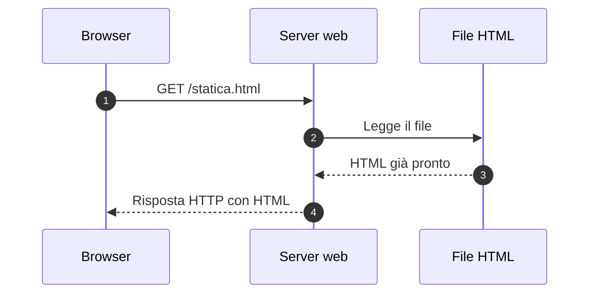
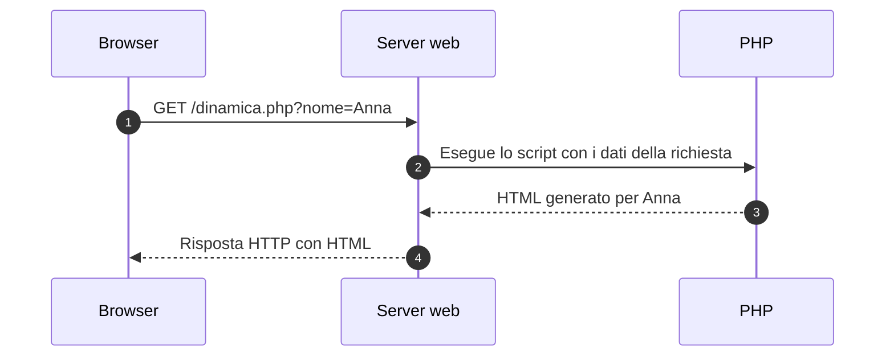

# Pagine web statiche e dinamiche

Una pagina web è un documento che il browser riceve e interpreta per mostrare contenuti all'utente.

- **HTML** descrive la struttura e il significato dei contenuti.
- **CSS** definisce la presentazione grafica.
- **JavaScript** può modificare la pagina nel browser e gestire le interazioni.
- **PHP** può generare il contenuto sul server prima di inviarlo al browser.

La distinzione tra pagine statiche e dinamiche riguarda **come viene prodotto il contenuto**.

<!--
Note del docente:
Collegare questa guida al modello client-server e al ciclo richiesta-risposta HTTP. Chiedere agli studenti se una pagina con animazioni debba essere necessariamente generata da PHP.
-->

---

# Pagine web statiche

Una pagina statica viene distribuita come un file già pronto: il server legge il file e lo invia al browser senza generare il documento mediante logica applicativa per quella richiesta.



Esempi comuni:

- una pagina di presentazione;
- la documentazione di un progetto;
- una pagina con contatti e orari.

> Il contenuto di un file statico può essere aggiornato: cambia quando viene modificato o rigenerato il file pubblicato.

<!--
Note del docente:
“Statico” non significa immutabile. Anche un sito generato automaticamente prima della pubblicazione può distribuire pagine statiche.
-->

---

# Esempio di pagina statica

Salva questo codice in `www/statica.html`:

```html
<!DOCTYPE html>
<html lang="it">
<head>
    <meta charset="UTF-8">
    <title>Pagina statica</title>
</head>
<body>
    <h1>Benvenuto al corso PHP!</h1>
    <p>Le lezioni iniziano alle 09:00.</p>
</body>
</html>
```

Il server invia il documento già scritto. Per cambiare l'orario mostrato devi modificare il file.

Apri la pagina, ricaricala e osserva che il testo rimane lo stesso finché il file non viene aggiornato.

<!--
Note del docente:
Mostrare la corrispondenza tra il file nell'editor e il documento HTML ricevuto dal browser. HTML e CSS vengono interpretati dal browser.
-->

---

# Pagine web dinamiche sul server

Una pagina dinamica sul server viene generata da un programma, per esempio uno script PHP, durante l'elaborazione di una richiesta.

Il contenuto può dipendere da:

- parametri nell'URL o dati di un form;
- utente autenticato e sessione;
- data e ora del server;
- dati letti da file, database o servizi esterni.



> Una pagina dinamica può funzionare senza database e può produrre lo stesso risultato in richieste successive.

<!--
Note del docente:
Il database è una possibile sorgente di dati. Non è un requisito per generare una pagina dinamica. Anche una risposta generata può essere memorizzata in cache e riutilizzata quando appropriato.
-->

---

# Esempio di pagina dinamica con PHP

Salva questo codice in `www/dinamica.php`:

```php
<?php
$nome = $_GET['nome'] ?? 'mondo';

// Accettiamo un nome testuale anche se la richiesta contiene dati inattesi.
if (!is_string($nome) || trim($nome) === '') {
    $nome = 'mondo';
}

// Codifica i caratteri speciali prima di inserire il nome nel testo HTML.
$nomeHtml = htmlspecialchars($nome, ENT_QUOTES | ENT_SUBSTITUTE, 'UTF-8');
$ora = date('H:i:s');
?>
<!DOCTYPE html>
<html lang="it">
<head>
    <meta charset="UTF-8">
    <title>Pagina dinamica</title>
</head>
<body>
    <h1>Ciao, <?= $nomeHtml ?>!</h1>
    <p>Ora del server: <?= $ora ?></p>
</body>
</html>
```

Confronta `/dinamica.php?nome=Anna` e `/dinamica.php?nome=Luca`: lo stesso script genera saluti diversi.

L'ora viene calcolata quando PHP elabora la richiesta e usa il fuso orario configurato sul server. Per aggiornarla in questa pagina devi effettuare una nuova richiesta, per esempio ricaricando la pagina dopo qualche secondo.

<!--
Note del docente:
<?= ... ?> è la forma breve di echo. htmlspecialchars() serve a rappresentare il nome come testo HTML: non verifica l'identità dell'utente e non rende automaticamente sicuro l'inserimento in JavaScript o in altri contesti.
-->

---

# Che cosa riceve il browser?

Per una richiesta con `nome=Anna`, la parte principale della risposta potrebbe essere:

```html
<h1>Ciao, Anna!</h1>
<p>Ora del server: 09:15:30</p>
```

Il browser riceve l'HTML generato. Le istruzioni PHP rimangono sul server, se il server è configurato per eseguirle correttamente.

| Nell'editor sul server | Nella risposta ricevuta |
|---|---|
| `$_GET['nome']` | Il nome inserito nel saluto |
| `date('H:i:s')` | L'ora calcolata durante la richiesta |
| `<?= $nomeHtml ?>` | Il testo prodotto da PHP |

Usa **Visualizza sorgente pagina** per osservare il documento ricevuto. Gli strumenti di sviluppo mostrano anche il **DOM corrente**, che JavaScript può aver modificato dopo il caricamento.

<!--
Note del docente:
Confrontare il file PHP, il corpo della risposta nel pannello Network e il DOM nel pannello Elements. Aprire un file PHP tramite file:// non attiva l'interprete PHP.
-->

---

# Contenuti dinamici nel browser

Una pagina distribuita come file statico può contenere JavaScript che modifica ciò che l'utente vede.

Questo frammento, inserito nel corpo di una pagina HTML, mostra un contatore:

```html
<button id="incrementa" type="button">Aumenta</button>
<p>Valore: <span id="valore">0</span></p>

<script>
    let contatore = 0;

    document.getElementById('incrementa').addEventListener('click', () => {
        contatore++;
        document.getElementById('valore').textContent = contatore;
    });
</script>
```

- Il server può inviare sempre lo stesso file HTML.
- JavaScript aggiorna il DOM nel browser a ogni clic.
- In questo esempio il clic non invia nuove richieste al server.
- Ricaricando la pagina il contatore riparte da zero.

> Una pagina può combinare generazione sul server con PHP e aggiornamenti nel browser con JavaScript.

<!--
Note del docente:
Un'animazione o un contatore non dimostrano che il documento sia generato sul server. JavaScript può anche richiedere dati con fetch(), ma in questo esempio lavora soltanto nel browser.
-->

---

# Confronto tra i tre casi

| Aspetto | HTML statico | HTML generato da PHP | HTML statico con JavaScript |
|---|---|---|---|
| Documento iniziale | File già pronto | Prodotto dall'applicazione sul server | File già pronto |
| Elaborazione dell'esempio | Il server legge il file | PHP legge nome e ora e genera HTML | Il browser esegue il contatore |
| Aggiornamento mostrato | Modifica del file e nuovo caricamento | Nuova richiesta allo script | Clic che modifica il DOM |
| Database necessario | No | No | No |
| Esempio d'uso | Pagina di contatti | Saluto personalizzato o area riservata | Contatore o menu interattivo |

L'estensione del file è un indizio, ma conta il comportamento del sistema: un URL può non avere estensione e uno script PHP può produrre sempre lo stesso HTML.

<!--
Note del docente:
Il file www/index.php del corso contiene attualmente HTML fisso. Confrontarlo con www/02-pagina-riservata/index.php, il cui contenuto dipende dalla sessione.
-->

---

# Prova nel progetto

Dalla cartella principale del progetto, se il server non è già in esecuzione:

```bash
php -S 0.0.0.0:8000 -t www
```

1. Crea i file `www/statica.html` e `www/dinamica.php` usando gli esempi della guida.
2. Apri `http://localhost:8000/statica.html`.
3. Apri `http://localhost:8000/dinamica.php?nome=Anna`.
4. Cambia il nome nell'URL e confronta le risposte.
5. Ricarica la pagina dinamica dopo qualche secondo e osserva l'ora.
6. Aggiungi il contatore alla pagina statica e osserva cosa accade dopo un clic e dopo un ricaricamento.

In Codespaces il server parte automaticamente con `www` come cartella pubblica: apri la porta **8000** dal pannello **Ports** e aggiungi il percorso della pagina all'URL inoltrato.

Gli esempi già disponibili nel progetto sono:

- [Hello PHP](../../www/01-hello-php/index.php): PHP stampa un saluto e le informazioni dell'interprete.
- [Pagina riservata](../../www/02-pagina-riservata/index.php): PHP mostra il form oppure il contenuto riservato in base alla sessione.

I link qui sopra aprono i file sorgente nel repository; dalla pagina iniziale del server puoi eseguire gli esempi nel browser.

---

# Verifica finale

1. Una pagina con un'animazione CSS è necessariamente generata sul server?
2. Uno script PHP che mostra l'ora richiede un database?
3. Perché il browser non vede `$_GET['nome']` nel sorgente della risposta PHP?
4. Nel contatore JavaScript, ogni clic provoca una nuova richiesta HTTP?
5. In quale momento viene eseguito `date('H:i:s')` nell'esempio PHP?
6. Perché il valore ricevuto nell'URL viene passato a `htmlspecialchars()`?

<!--
Risposte per il docente:
1. No: l'animazione può essere eseguita dal browser su una pagina statica.
2. No: PHP può usare direttamente la data e l'ora del server.
3. PHP viene eseguito sul server e la risposta contiene il risultato dell'elaborazione.
4. No: il codice dell'esempio modifica soltanto il DOM locale.
5. Quando PHP elabora la richiesta; l'ora non continua ad aggiornarsi da sola nel browser.
6. Per rappresentare i caratteri speciali come testo HTML invece di interpretarli come markup.
-->

---

[Guida precedente](03-il_protocollo_http.md) · [Guida successiva](05-sviluppo_server_side.md) · [Indice dell'introduzione](README.md)
