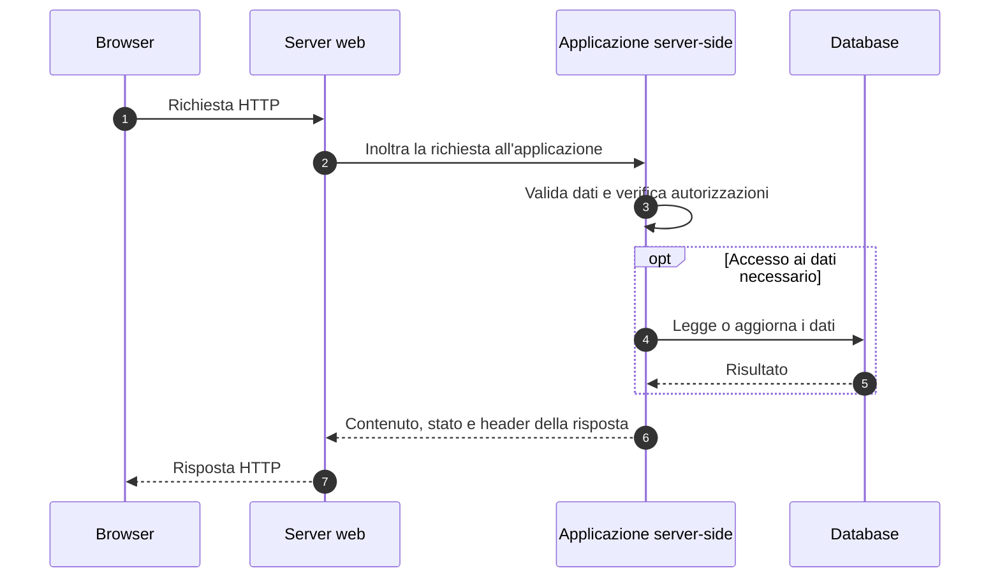
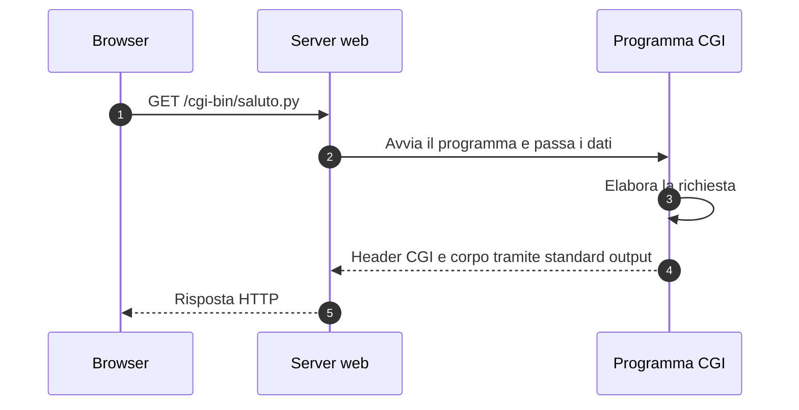
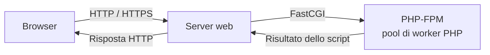

# Sviluppo server-side

Lo **sviluppo server-side** riguarda il codice eseguito sul server per elaborare richieste, applicare le regole dell'applicazione e produrre risposte.

Un'applicazione può restituire una pagina HTML, dati JSON, un file oppure un reindirizzamento.

Esempi:

- verificare le credenziali di un utente;
- mostrare il catalogo dei prodotti disponibili;
- registrare una prenotazione;
- fornire dati a un'applicazione mobile tramite un'API.

> PHP è uno dei linguaggi con cui possiamo realizzare la parte server di un'applicazione web.

<!--
Note del docente:
Riprendere la guida sulle pagine statiche e dinamiche. Il backend può generare HTML completo oppure fornire dati che il frontend usa per aggiornare l'interfaccia.
-->

---

# Frontend e backend

| Aspetto | Frontend | Backend |
|---|---|---|
| Dove viene eseguito il codice | Nel browser, in un'applicazione web | Sul server |
| Responsabilità | Presentazione e interazione | Regole applicative, accesso ai dati e autorizzazioni |
| Tecnologie di esempio | HTML, CSS, JavaScript | PHP, Python, Java, C# e altri linguaggi |
| Esempio nel login | Mostra il form e raccoglie i dati | Verifica le credenziali e gestisce la sessione |

Il frontend può controllare che un campo sia compilato per aiutare l'utente. Il backend deve comunque validare i dati ricevuti e verificare i permessi: una richiesta può essere inviata anche senza usare il form previsto.

<!--
Note del docente:
JavaScript può essere usato anche sul server. Frontend e backend indicano ruoli e ambienti di esecuzione, non categorie rigide di linguaggi.
-->

---

# Il ciclo di elaborazione sul server



Il **server web** gestisce lo scambio HTTP e può distribuire file statici. L'**applicazione** realizza le funzioni del sito. I due ruoli possono essere ospitati nello stesso processo oppure in processi separati.

<!--
Note del docente:
Il diagramma separa responsabilità logiche. Il server integrato di PHP riunisce in un ambiente di sviluppo la gestione HTTP e l'esecuzione degli script.
-->

---

# Common Gateway Interface (CGI)

La **Common Gateway Interface**, abbreviata **CGI**, definisce un'interfaccia con cui un server web passa una richiesta a un programma e ne recupera il risultato.

CGI specifica come rendere disponibili i dati della richiesta e come restituire la risposta. Il programma può essere scritto in linguaggi diversi.

> CGI è un'interfaccia tra server e programma, non un linguaggio di programmazione.

La descrizione di CGI/1.1 è pubblicata nella [RFC 3875](https://www.rfc-editor.org/info/rfc3875/).

<!--
Note del docente:
La RFC 3875 è un documento Informational che descrive CGI/1.1. Non presentarla come uno standard Internet approvato. Il termine “script CGI” può indicare anche un programma compilato.
-->

---

# Come funziona CGI



Nell'implementazione classica il server avvia un processo per ogni richiesta CGI. Il programma riceve metadati tramite variabili d'ambiente, legge l'eventuale corpo dallo **standard input** e scrive la risposta sullo **standard output**.

Il server gestisce la connessione con il browser. Il programma CGI produce l'output per il server. La [specifica FastCGI](https://fastcgi-archives.github.io/FastCGI_Specification.html) descrive questo modello classico e i suoi costi di avvio.

<!--
Note del docente:
“Un processo per richiesta” descrive il modello CGI classico, non un requisito universale dell'interfaccia astratta descritta dalla RFC. Distinguere la connessione HTTP dai canali di comunicazione locali con il programma.
-->

---

# I dati della richiesta in CGI

| Variabile | Informazione | Esempio |
|---|---|---|
| `REQUEST_METHOD` | Metodo HTTP | `GET`, `POST` |
| `QUERY_STRING` | Parametri dell'URL, ancora codificati | `nome=Anna&classe=3A` |
| `CONTENT_TYPE` | Tipo del corpo ricevuto | `application/x-www-form-urlencoded` |
| `CONTENT_LENGTH` | Lunghezza del corpo in byte, quando presente | `19` |
| `SCRIPT_NAME` | Percorso URL che identifica lo script | `/cgi-bin/saluto.py` |

Il corpo di una richiesta `POST` può contenere dati di un form oppure altri formati, come JSON. Il programma lo interpreta secondo il tipo dichiarato.

Queste informazioni e le regole di lettura del corpo sono descritte nella [sezione 4 della RFC 3875](https://www.rfc-editor.org/info/rfc3875/#section-4).

<!--
Note del docente:
QUERY_STRING non è il corpo della richiesta. Non tutti i metadati hanno sempre un valore. Non dividere manualmente i parametri senza considerare la codifica URL: usare le librerie del linguaggio.
-->

---

# Un piccolo programma CGI

Questo esempio Python mostra un saluto e il metodo ricevuto:

```python
#!/usr/bin/env python3
import os

metodo = os.environ.get('REQUEST_METHOD', 'non specificato')

print('Content-Type: text/plain; charset=utf-8')
print()
print('Ciao dal programma CGI!')
print(f'Metodo della richiesta: {metodo}')
```

La prima riga dell'output indica il tipo di contenuto. La riga vuota separa gli header dal corpo. Nell'uso CGI normale è il server a costruire la risposta HTTP per il client.

Per eseguirlo via browser servono un server configurato per CGI, l'interprete e i permessi appropriati. Copiare un file `.py` in `www` non lo rende eseguibile dal server PHP del corso.

Il [tutorial CGI di Apache](https://httpd.apache.org/docs/2.4/howto/cgi.html) illustra la configurazione e un esempio analogo.

<!--
Note del docente:
L'esempio restituisce testo semplice, non HTML. Può essere eseguito da terminale per osservare l'output, ma ciò non costituisce uno scambio HTTP. La cartella cgi-bin è una convenzione configurabile del server.
-->

---

# Dal CGI classico a FastCGI

Avviare un processo e inizializzare l'ambiente a ogni richiesta può diventare costoso.

**FastCGI** permette di mantenere processi applicativi attivi e riutilizzarli per richieste successive. Server e applicazione comunicano tramite un protocollo dedicato, usando per esempio un socket locale o una connessione TCP.

| Aspetto | CGI classico | FastCGI |
|---|---|---|
| Durata del processo applicativo | Tipicamente una richiesta | Può servire più richieste successive |
| Avvio dell'ambiente | Ripetuto per richiesta | Riutilizzato tra richieste |
| Comunicazione con il server | Ambiente, standard input e output | Protocollo FastCGI |

FastCGI conserva il modello di dati di CGI ma cambia il modo in cui vengono trasportati e gestiti. Il browser continua a comunicare tramite HTTP o HTTPS. Riferimento: [specifica FastCGI](https://fastcgi-archives.github.io/FastCGI_Specification.html).

<!--
Note del docente:
FastCGI non è una versione di HTTP. Riutilizzare un processo non significa che un singolo worker esegua necessariamente più richieste in parallelo.
-->

---

# PHP e PHP-FPM

**PHP-FPM**, FastCGI Process Manager, è un'implementazione FastCGI per PHP che gestisce gruppi di processi, chiamati **pool**, e i relativi worker.



Il server web inoltra le richieste PHP a PHP-FPM e riceve il risultato degli script. I worker possono essere riutilizzati, mentre variabili locali come `$nome` non conservano automaticamente i dati dell'utente tra richieste: per questo si usano sessioni, database o altri sistemi di persistenza.

Le funzioni di gestione dei processi sono descritte nel [manuale ufficiale di PHP-FPM](https://www.php.net/manual/en/install.fpm.php).

<!--
Note del docente:
PHP-FPM non è un framework e non sostituisce il server HTTP. Il modello presentato è una modalità di esecuzione di PHP, non l'unica possibile.
-->

---

# Il server usato nel corso

Nel progetto avviamo PHP con:

```bash
php -S 0.0.0.0:8000 -t www
```

- `-S` avvia il server web integrato per lo sviluppo.
- `0.0.0.0:8000` imposta indirizzo di ascolto e porta.
- `-t www` imposta la cartella pubblica.

Questo comando esegue gli script PHP senza configurare CGI o PHP-FPM. È adatto alle esercitazioni; il [manuale del server integrato](https://www.php.net/manual/en/features.commandline.webserver.php) ne indica l'uso per sviluppo e prove, anziché per ospitare un servizio pubblico in produzione.

In Codespaces il progetto avvia già questo server e inoltra la porta **8000**.

<!--
Note del docente:
Evitare di avviare una seconda istanza sulla stessa porta. Mostrare che modalità di esecuzione, codice PHP e protocollo HTTP sono aspetti distinti.
-->

---

# I principali linguaggi server-side

Linguaggi diversi permettono di realizzare pagine dinamiche e API. La tabella offre una panoramica, senza costituire una classifica di diffusione o prestazioni.

| Linguaggio | Ambiente o strumenti di esempio | Impiego nel backend |
|---|---|---|
| **PHP** | Interprete PHP, eventualmente gestito da [PHP-FPM](https://www.php.net/manual/en/install.fpm.php) | Pagine dinamiche, form, sessioni e API |
| **Python** | Framework [Django](https://docs.djangoproject.com/en/stable/intro/overview/) | Applicazioni web con gestione dei dati, viste e template |
| **JavaScript / TypeScript** | Runtime [Node.js](https://nodejs.org/en/learn/getting-started/introduction-to-nodejs) e strumenti per [TypeScript](https://nodejs.org/en/learn/typescript/introduction) | Server HTTP, API e applicazioni di rete |
| **Java** | JVM e framework [Spring Boot](https://spring.io/guides/gs/rest-service/) | Servizi REST e applicazioni web |
| **C#** | .NET e framework [ASP.NET Core](https://learn.microsoft.com/en-us/aspnet/core/overview) | Applicazioni web e servizi HTTP |
| **Ruby** | Framework [Ruby on Rails](https://guides.rubyonrails.org/getting_started.html) | Applicazioni web con modelli, controller e viste |
| **Go** | Libreria standard `net/http`, illustrata nella [guida alle applicazioni web](https://go.dev/doc/articles/wiki/) | Server HTTP e servizi web |

<!--
Note del docente:
Chiedere quali linguaggi gli studenti conoscono già. Gli strumenti indicati sono esempi: nessun linguaggio della tabella è limitato a un solo framework o a un solo tipo di progetto.
-->

---

# Linguaggio, runtime, framework e interfaccia

| Termine | Che cosa indica | Esempi |
|---|---|---|
| **Linguaggio** | Regole con cui si scrive il programma | PHP, Python, JavaScript, Java, C# |
| **Runtime o interprete** | Ambiente che esegue il programma | Interprete PHP, Node.js, JVM, .NET |
| **Framework** | Struttura e componenti per organizzare l'applicazione | Django, Spring Boot, ASP.NET Core, Rails |
| **Interfaccia o protocollo di integrazione** | Modalità con cui server e applicazione si scambiano i dati | CGI, FastCGI |

**Node.js è un runtime**, mentre **JavaScript è un linguaggio**. Analogamente, **Django è un framework**, mentre **Python è un linguaggio**. Vedi le introduzioni ufficiali a [Node.js](https://nodejs.org/en/learn/getting-started/introduction-to-nodejs) e [Django](https://docs.djangoproject.com/en/stable/intro/overview/).

La scelta del linguaggio dipende dalle competenze del gruppo, dalle librerie disponibili, dall'infrastruttura e dalle esigenze del progetto.

<!--
Note del docente:
Un'applicazione può anche esporre direttamente un server HTTP, eventualmente dietro un reverse proxy. CGI e FastCGI non sono passaggi obbligatori per ogni backend.
-->

---

# Collegamento con gli esempi del corso

Apri la pagina iniziale del server e prova **Pagina riservata**:

1. Il browser mostra il form HTML.
2. Il form invia nome utente e password con `POST`.
3. PHP legge i dati e confronta le credenziali dimostrative.
4. Se il controllo riesce, PHP registra l'utente nella sessione.
5. Alle richieste successive PHP usa la sessione per mostrare il contenuto riservato.

Puoi leggere il [sorgente del login](../../www/02-pagina-riservata/index.php) e il [sorgente di Hello PHP](../../www/01-hello-php/index.php). Questi link aprono i file nel repository; per eseguirli usa i collegamenti della pagina iniziale sulla porta 8000.

<!--
Note del docente:
Il login usa credenziali fisse per isolare il ciclo richiesta-risposta e le sessioni. Non presentarlo come un sistema di autenticazione completo con database.
-->

---

# Verifica finale

1. Quali controlli deve eseguire il backend quando riceve un form di login?
2. CGI è un linguaggio, un framework oppure un'interfaccia?
3. Dove trova un programma CGI il metodo HTTP e l'eventuale corpo della richiesta?
4. Che cosa separa gli header dal corpo nell'output dell'esempio CGI?
5. Quale costo del modello CGI classico viene ridotto riutilizzando i processi con FastCGI?
6. Qual è il ruolo di PHP-FPM?
7. Node.js e JavaScript indicano la stessa cosa?
8. Il comando `php -S 0.0.0.0:8000 -t www` richiede PHP-FPM?

<!--
Risposte per il docente:
1. Deve validare i dati, verificare le credenziali e gestire lo stato di autenticazione; l'accesso alle risorse richiede anche controlli di autorizzazione.
2. Un'interfaccia tra server web e programma.
3. Il metodo è disponibile tramite REQUEST_METHOD; l'eventuale corpo viene letto dallo standard input.
4. Una riga vuota.
5. Il costo di avviare un nuovo processo e inizializzare l'ambiente a ogni richiesta.
6. Gestisce processi PHP che comunicano con il server web tramite FastCGI.
7. No: Node.js è un runtime che permette di eseguire JavaScript anche sul server.
8. No: avvia il server web integrato di PHP.
-->

---

[Guida precedente: Pagine web statiche e dinamiche](04-pagine_web_statiche_e_dinamiche.md) · [Indice dell'introduzione](README.md)
