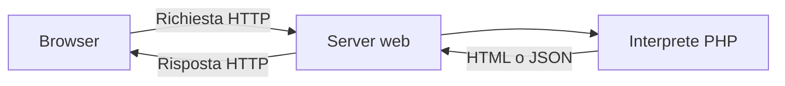
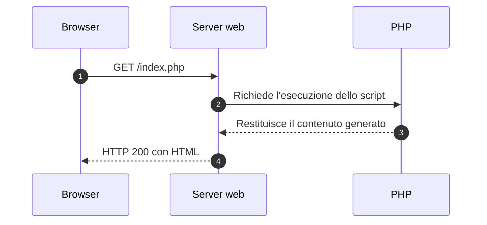
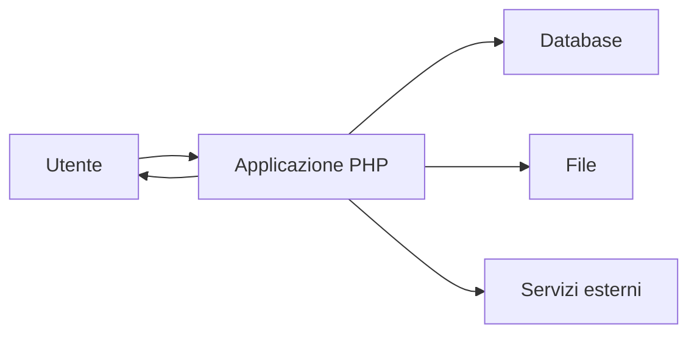

# Introduzione a PHP

**PHP**, PHP: Hypertext Preprocessor, è un linguaggio di scripting progettato soprattutto per lo sviluppo web lato server.

- il server esegue il codice PHP;
- PHP può generare HTML, JSON e altri formati;
- il browser riceve il risultato, non il codice sorgente;
- il linguaggio è open source e multipiattaforma;
- i file PHP usano normalmente l'estensione `.php`.



> PHP lavora sul server e produce il contenuto inviato al client.

<!--
Note del docente:
Confrontare PHP con JavaScript eseguito nel browser. JavaScript può essere usato anche sul server, ma nel corso PHP interessa soprattutto la distinzione tra codice client e codice server.
-->

---

# Esecuzione di una pagina PHP



Il browser non interpreta le istruzioni PHP.

| Sul server | Nel browser |
|---|---|
| Codice PHP | HTML generato |
| Logica applicativa | Struttura della pagina |
| Accesso al database | CSS e JavaScript ricevuti |
| Gestione delle sessioni | Visualizzazione e interazione |

<!--
Note del docente:
Aprire il sorgente della pagina nel browser e far notare che le istruzioni PHP non compaiono nella risposta.
-->

---

# Cosa può fare PHP

PHP permette di realizzare pagine e servizi web dinamici.

- elaborare dati provenienti da moduli HTML;
- generare pagine personalizzate;
- leggere e modificare dati in un database;
- gestire autenticazione, cookie e sessioni;
- leggere e scrivere file sul server;
- inviare email e comunicare con servizi esterni;
- creare API che restituiscono dati JSON.



> PHP implementa la logica applicativa e coordina l'accesso alle risorse del server.

<!--
Note del docente:
Usare esempi vicini agli studenti: login, registro di prodotti, prenotazioni, blog e API per un'app mobile.
-->

---

# Ambiente di sviluppo

Per eseguire PHP servono almeno:

1. l'**interprete PHP**;
2. un **server web**, oppure il server integrato per lo sviluppo;
3. un browser e un editor di codice.

Un database, come MySQL o MariaDB, diventa necessario quando l'applicazione deve conservare dati strutturati.

Esempi di ambienti locali:

- pacchetti integrati come XAMPP o Laragon;
- stack LAMP o LEMP;
- container Docker;
- installazione diretta di PHP e del server web.

Per una prova locale rapida:

```bash
php -S localhost:8000
```

> Il server integrato di PHP è destinato allo sviluppo, non alla pubblicazione in produzione.

<!--
Note del docente:
Eseguire il comando nella cartella del progetto e aprire http://localhost:8000 nel browser.
-->

---

# Il primo programma PHP

File `index.php`:

```php
<?php
echo "Ciao, mondo!";
?>
```

Quando il browser richiede `index.php`:

1. il server individua il file;
2. PHP esegue l'istruzione `echo`;
3. il server invia il testo generato nella risposta HTTP.

Risultato ricevuto dal browser:

```text
Ciao, mondo!
```

La chiusura `?>` può essere omessa nei file che contengono soltanto codice PHP.

<!--
Note del docente:
L'omissione del tag di chiusura nei file solo PHP evita l'invio accidentale di spazi o righe vuote dopo il codice.
-->

---

# Sintassi fondamentale

```php
<?php
// Commento su una riga

/*
   Commento su più righe
*/

$messaggio = "Benvenuto nel corso PHP";
echo $messaggio;
```

Regole principali:

- il codice PHP si trova tra `<?php` e `?>`;
- le istruzioni terminano normalmente con `;`;
- i nomi delle variabili iniziano con `$`;
- i nomi delle variabili distinguono maiuscole e minuscole;
- gli spazi e le righe vuote migliorano la leggibilità senza cambiare il risultato.

> `$nome` e `$Nome` indicano due variabili differenti.

<!--
Note del docente:
Mostrare un errore causato dall'assenza del punto e virgola e leggere insieme il messaggio prodotto da PHP.
-->

---

# Variabili e tipi di dato

```php
<?php
$nome = "Anna";                  // string
$eta = 17;                       // int
$media = 8.5;                    // float
$iscritta = true;                // bool
$linguaggi = ["PHP", "JavaScript"]; // array
$assenza = null;                 // null
```

PHP determina il tipo dal valore assegnato. Il tipo di una variabile può cambiare durante l'esecuzione.

```php
$valore = 10;
$valore = "dieci";
```

Le dichiarazioni di tipo rendono più chiari parametri e valori restituiti:

```php
function somma(int $a, int $b): int
{
    return $a + $b;
}
```

<!--
Note del docente:
Presentare la tipizzazione dinamica senza incoraggiare cambi di tipo non necessari. Le dichiarazioni di tipo migliorano leggibilità e controllo degli errori.
-->

---

# PHP e HTML nella stessa pagina

PHP può essere inserito all'interno di un documento HTML.

```php
<?php
$titolo = "Elenco studenti";
$studenti = ["Anna", "Luca", "Sara"];
?>

<!DOCTYPE html>
<html lang="it">
<head>
    <meta charset="UTF-8">
    <title><?= htmlspecialchars($titolo) ?></title>
</head>
<body>
    <h1><?= htmlspecialchars($titolo) ?></h1>
    <ul>
        <?php foreach ($studenti as $studente): ?>
            <li><?= htmlspecialchars($studente) ?></li>
        <?php endforeach; ?>
    </ul>
</body>
</html>
```

La forma abbreviata `<?= ... ?>` equivale a usare `echo` per produrre un valore.

<!--
Note del docente:
Evidenziare la sintassi alternativa di foreach, adatta ai template HTML, e il ruolo di htmlspecialchars nell'output.
-->

---

# Ricevere dati dal browser

Richiesta di esempio:

```text
http://localhost:8000/saluto.php?nome=Anna
```

File `saluto.php`:

```php
<?php
$nome = filter_input(INPUT_GET, 'nome');

if ($nome === null || $nome === false || trim($nome) === '') {
    $nome = 'visitatore';
}

$nomeHtml = htmlspecialchars(
    $nome,
    ENT_QUOTES | ENT_SUBSTITUTE,
    'UTF-8'
);
?>

<h1>Benvenuto, <?= $nomeHtml ?>!</h1>
```

I dati ricevuti dall'utente devono essere **validati** prima dell'uso e **codificati** in base al contesto di destinazione.

<!--
Note del docente:
Spiegare che validazione e codifica dell'output sono operazioni differenti. htmlspecialchars protegge il contesto HTML, ma non valida il significato del dato.
-->

---

# Generare una risposta JSON

PHP può produrre dati destinati a JavaScript, app mobili o altri servizi.

```php
<?php
header('Content-Type: application/json; charset=utf-8');

$prodotto = [
    'id' => 25,
    'nome' => 'Notebook',
    'prezzo' => 599.90
];

echo json_encode(
    $prodotto,
    JSON_UNESCAPED_UNICODE | JSON_PRETTY_PRINT
);
```

Risposta:

```json
{
    "id": 25,
    "nome": "Notebook",
    "prezzo": 599.9
}
```

L'header `Content-Type` permette al client di interpretare correttamente il corpo della risposta.

<!--
Note del docente:
Collegare questo esempio al consumo di API mediante fetch in JavaScript.
-->

---

# Errori, debug e sicurezza

Durante lo sviluppo è utile visualizzare tutti gli errori:

```php
<?php
error_reporting(E_ALL);
ini_set('display_errors', '1');
```

In produzione, l'applicazione deve registrare gli errori nei log senza mostrarne i dettagli agli utenti.

Principi da applicare fin dai primi esercizi:

- non considerare attendibili i dati ricevuti dal client;
- codificare l'output HTML con `htmlspecialchars()`;
- usare query preparate per accedere al database;
- usare `password_hash()` e `password_verify()` per le password;
- evitare di inserire password e chiavi direttamente nel codice sorgente.

> Un messaggio di errore dettagliato aiuta lo sviluppatore, ma può fornire informazioni utili a un attaccante.

<!--
Note del docente:
Distinguere ambiente di sviluppo e ambiente di produzione. Introdurre i log come fonte principale per la diagnosi degli errori in produzione.
-->

---

# Prima attività di laboratorio

Realizzare il file `presentazione.php`.

Requisiti:

1. leggere dalla query string i parametri `nome` ed `eta`;
2. controllare che `nome` non sia vuoto;
3. verificare che `eta` sia un numero intero positivo;
4. codificare il nome con `htmlspecialchars()`;
5. generare una pagina HTML con un messaggio personalizzato;
6. mostrare un messaggio chiaro quando i dati non sono validi.

URL di prova:

```text
http://localhost:8000/presentazione.php?nome=Anna&eta=17
```

## Domanda di verifica

Perché il browser non può visualizzare il codice PHP originale usando il comando “Visualizza sorgente pagina”?

<!--
Risposta per il docente:
Il server esegue il codice PHP prima di inviare la risposta. Il browser riceve soltanto l'output generato, per esempio HTML o JSON.
-->
