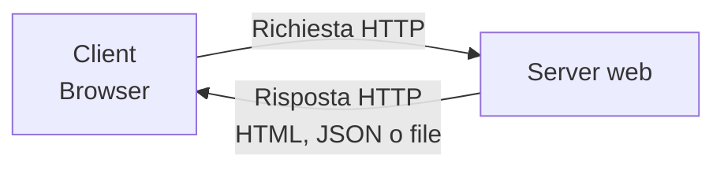
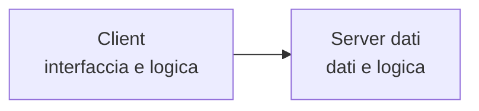
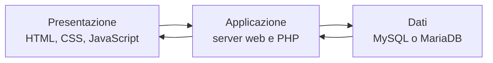
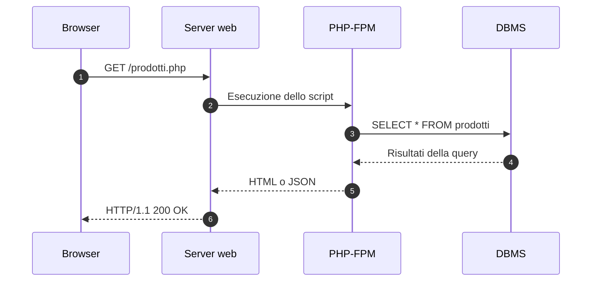
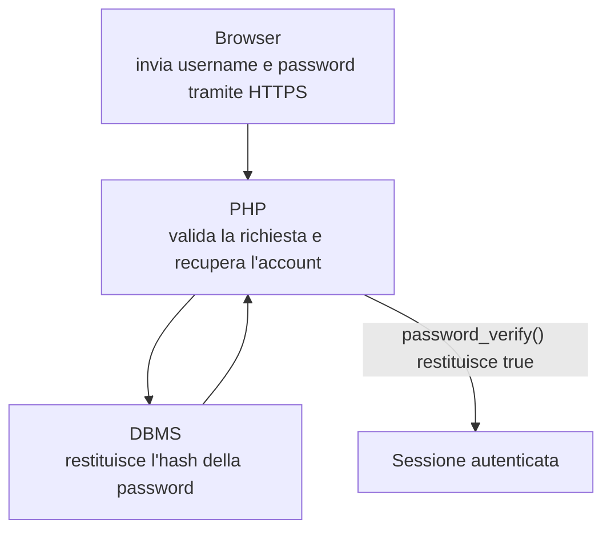
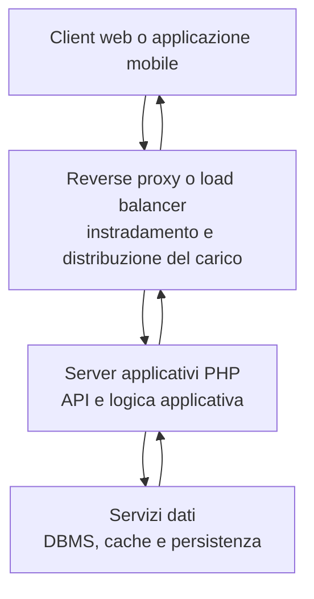

# Il modello client-server

Il modello client-server organizza la comunicazione tra due componenti software:

- il **client** richiede una risorsa o un servizio;
- il **server** riceve la richiesta, la elabora e restituisce una risposta;
- la comunicazione usa protocolli di rete, come **HTTP** e **HTTPS**.



> Il client avvia la comunicazione. Il server fornisce il servizio richiesto.

<!--
Note del docente:
Chiedere agli studenti di indicare altri esempi di client, come un'applicazione mobile o un programma da riga di comando.
-->

---

# Architetture a due e a tre livelli

## Modello a due livelli

Il client comunica direttamente con il componente che gestisce i dati e parte della logica applicativa.



## Modello a tre livelli



La separazione delle responsabilità permette di modificare e gestire i livelli con maggiore indipendenza.

<!--
Note del docente:
I livelli rappresentano responsabilità logiche. Non devono necessariamente essere ospitati su computer differenti.
-->

---

# Il ruolo di PHP

| Livello | Tecnologie | Funzione |
|---|---|---|
| **Presentazione** | HTML, CSS, JavaScript | Mostra l'interfaccia e gestisce l'interazione con l'utente |
| **Applicazione** | Server web, PHP | Applica le regole, valida i dati e gestisce le sessioni |
| **Dati** | MySQL, MariaDB, PostgreSQL | Memorizza, ricerca e aggiorna i dati persistenti |

```php
<?php
$nome = "Mario";
echo "<h1>Benvenuto, $nome!</h1>";
?>
```

Il browser riceve il risultato dell'elaborazione:

```html
<h1>Benvenuto, Mario!</h1>
```

> PHP viene eseguito sul server. Il codice sorgente PHP non viene inviato al client.

<!--
Note del docente:
Confrontare il file PHP presente sul server con il codice HTML ricevuto dal browser.
-->

---

# Elaborazione di una richiesta HTTP



Durante l'elaborazione:

1. PHP applica la logica dell'applicazione.
2. Il DBMS esegue la query SQL e restituisce i dati.
3. PHP genera la rappresentazione destinata al client.

<!--
Note del docente:
Precisare che PHP comunica con il DBMS mediante il driver e il protocollo specifici del database, non tramite HTTP.
-->

---

# Esempio: autenticazione di un utente



Controlli fondamentali:

- il browser non accede direttamente al database;
- PHP valida i dati e applica le regole di accesso;
- il database conserva l'**hash** della password, non la password in chiaro;
- dopo la verifica, PHP può creare una sessione autenticata.

<!--
Note del docente:
password_verify() confronta la password inserita con l'hash memorizzato. La sessione conserva sul server lo stato dell'autenticazione.
-->

---

# Architetture a più livelli

Il modello a tre livelli può essere suddiviso in componenti più specializzati.



- In fase di sviluppo, più livelli possono condividere lo stesso computer.
- In produzione, i componenti più utilizzati possono essere replicati.
- Il database può rimanere isolato dalla rete pubblica.

> Un livello descrive una responsabilità architetturale, non una macchina fisica.

<!--
Note del docente:
Un reverse proxy può terminare HTTPS e distribuire le richieste tra più istanze dell'applicazione PHP.
-->

---

# Vantaggi e aspetti da considerare

| Vantaggio | Effetto sull'applicazione |
|---|---|
| **Modularità** | Ogni livello svolge funzioni definite |
| **Manutenibilità** | Le modifiche restano più facilmente circoscritte |
| **Scalabilità** | Si potenziano o replicano i componenti maggiormente utilizzati |
| **Sicurezza** | L'accesso ai dati passa dal livello applicativo |
| **Riusabilità** | Le stesse API possono servire client differenti |

L'aumento del numero di livelli comporta anche:

- più componenti da configurare e monitorare;
- più comunicazioni di rete;
- possibile aumento della latenza.

## Domanda di verifica

Apache, PHP e MariaDB sono installati sullo stesso computer. L'applicazione può avere comunque tre livelli?

<!--
Risposta per il docente:
Sì. I livelli sono distinti in base alle responsabilità architetturali e non devono essere eseguiti su computer differenti.
-->
