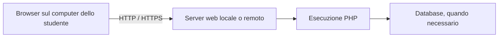

# Componenti e strumenti dell'ambiente di sviluppo

Un ambiente di sviluppo riunisce i programmi con cui scriviamo, eseguiamo e
verifichiamo il codice. Il browser visualizza il risultato; PHP deve essere
eseguito da un interprete sul computer locale oppure su un server remoto.

---

# I componenti

| Componente | Responsabilità | Esempi |
|---|---|---|
| Editor o IDE | Scrivere e navigare il codice | Visual Studio Code, editor nel browser |
| Interprete PHP | Eseguire gli script | PHP da terminale, PHP integrato nel servizio web |
| Server web | Ricevere richieste HTTP e inviare risposte | Server integrato PHP, Apache, Nginx |
| Gestore FastCGI | Gestire i processi PHP per un server web | PHP-FPM |
| Database | Conservare dati persistenti | MySQL, MariaDB |
| Gestore delle dipendenze | Installare le librerie del progetto | Composer |
| Controllo di versione | Registrare modifiche e collaborare | Git e repository su GitHub |

Apache o Nginx devono essere collegati a un ambiente di esecuzione PHP. Installare
soltanto il server web non garantisce che i file `.php` vengano eseguiti.

Per il collegamento con PHP-FPM consulta il [manuale PHP](https://www.php.net/manual/en/install.fpm.php).

<!--
Note del docente:
Far associare a ogni componente un'azione concreta: modificare un file, ricevere una richiesta, eseguire lo script, leggere i dati e registrare una modifica.
-->

---

# Locale e remoto



Con un ambiente **locale**, il proprio computer esegue anche il server. Con un
ambiente **remoto**, gli script sono eseguiti su un'altra macchina: Web4Student
o un Codespace, per esempio.

Il significato di `localhost` dipende dal programma che lo usa. Nel browser
del tuo computer indica il tuo computer; nel terminale remoto indica l'ambiente
remoto. Un URL inoltrato da Codespaces collega il browser al servizio remoto.
Il funzionamento dell'inoltro è descritto nella [documentazione GitHub](https://docs.github.com/en/codespaces/developing-in-a-codespace/forwarding-ports-in-your-codespace).

---

# Cartella del progetto e cartella pubblica

Nel repository del corso:

```text
Learning-PHP-by-example/
├── .devcontainer/     configurazione dell'ambiente Codespaces
├── docs/             guide del corso
└── www/              pagine accessibili tramite il server web
    ├── index.php
    ├── 01-hello-php/
    └── 02-pagina-riservata/
```

Il server deve pubblicare `www`. La cartella del repository contiene anche file
di lavoro e configurazione che non servono al browser.

| Ambiente | Come si indica la cartella pubblica |
|---|---|
| Server integrato PHP | Opzione `-t www` |
| Apache | Direttiva `DocumentRoot` |
| Nginx | Direttiva `root` |
| Web4Student | Cartella personale `~/www` |
| XAMPP con virtual host | `DocumentRoot` del virtual host |

---

# Prima esecuzione

Se PHP è installato, dalla cartella principale del repository:

```bash
php --version
php --ini
php -m
php -l www/01-hello-php/index.php
php -S 0.0.0.0:8000 -t www
```

I comandi mostrano versione, configurazione, moduli caricati e controllo della
sintassi; l'ultimo avvia il server. Apri `http://localhost:8000` in locale,
oppure la porta inoltrata in Codespaces. Non avviare una seconda istanza se il
progetto ha già avviato il servizio.

Il [server integrato PHP](https://www.php.net/manual/en/features.commandline.webserver.php)
serve per sviluppo e prove; non richiede Apache o Nginx.

---

# Controlli quando una pagina non funziona

| Sintomo | Primo controllo |
|---|---|
| Connessione rifiutata | Il server è in esecuzione sulla porta corretta? |
| Risposta 404 | Il percorso richiesto esiste nella cartella pubblica? |
| Sorgente PHP visibile | Il servizio sta eseguendo PHP oppure distribuendo il file come testo? |
| Errore PHP o risposta 500 | Quale messaggio compare nel terminale o nel log degli errori? |
| Modifica non visibile | Hai modificato il file dell'ambiente che stai aprendo? |

## Attività

Esegui gli esempi iniziali e annota versione PHP, porta, cartella pubblica e URL.
Spiega perché aprire uno script con `file://` non equivale a richiederlo al server.

---

[Indice del capitolo](README.md) · [Guida successiva: Web4Student](02-web4student.md)
