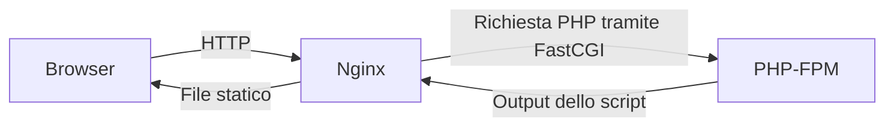

# Nginx e sua configurazione

**Nginx** può distribuire file statici e inoltrare richieste a un'applicazione.
Per eseguire PHP lo colleghiamo a PHP-FPM tramite FastCGI.



La [guida introduttiva ufficiale](https://nginx.org/en/docs/beginners_guide.html)
illustra struttura dei file, distribuzione dei contenuti e collegamento FastCGI.

---

# Struttura della configurazione

| Elemento | Responsabilità |
|---|---|
| `http` | Contesto della configurazione HTTP |
| `server` | Configurazione di un sito, detto anche server block |
| `listen` | Indirizzo e porta |
| `server_name` | Nome del sito |
| `root` | Cartella pubblica |
| `location` | Regole in base al percorso richiesto |
| `index` | File da cercare per una richiesta a una cartella |
| `fastcgi_pass` | Destinazione PHP-FPM |

Il file principale è spesso `/etc/nginx/nginx.conf`. Su Ubuntu i siti possono
essere organizzati in `sites-available` e `sites-enabled`; questa organizzazione
dipende dal pacchetto e dagli `include` del file principale.
Vedi la [guida Ubuntu a Nginx](https://ubuntu.com/server/docs/how-to/web-services/install-nginx/).

---

# Esempio di server block per il corso

Supponiamo che il progetto sia in `/srv/corso-php` e che PHP-FPM ascolti su
`/run/php/php8.3-fpm.sock`. Adatta entrambi i percorsi alla tua installazione.

Inserisci questo blocco nel contesto `http`, per esempio in un file
`/etc/nginx/sites-available/corso-php` incluso dalla configurazione Ubuntu:

```nginx
server {
    listen 127.0.0.1:8081;
    server_name localhost;

    root /srv/corso-php/www;
    index index.php index.html;
    autoindex off;
    client_max_body_size 10m;

    access_log /var/log/nginx/corso-php-access.log;
    error_log /var/log/nginx/corso-php-error.log;

    location / {
        try_files $uri $uri/ =404;
    }

    location ~ /\. {
        deny all;
    }

    location ~ \.php$ {
        try_files $uri =404;
        include fastcgi_params;
        fastcgi_param SCRIPT_FILENAME $document_root$fastcgi_script_name;
        fastcgi_pass unix:/run/php/php8.3-fpm.sock;
    }
}
```

La porta **8081** permette di distinguere questa prova dall'esempio Apache
sulla 8080 e dal server PHP sulla 8000. L'indirizzo di ascolto limita questa
prova al computer locale.

---

# File statici e richieste PHP

`root` individua `www`. Il blocco `location /` cerca un file o una directory
esistente, altrimenti restituisce 404: gli esempi del corso non richiedono un
router o un reindirizzamento generale a `index.php`.

La regola per i percorsi che contengono un componente nascosto precede la
regola PHP. Il blocco PHP controlla che il file esista prima di inoltrarlo.

`SCRIPT_FILENAME` comunica a FPM il percorso dello script sul filesystem.
In questo esempio Nginx e FPM devono vedere i file allo stesso percorso;
con container separati va verificata la corrispondenza dei volumi.

Il file incluso `fastcgi_params` fornisce gli altri parametri della richiesta.
Se il tuo pacchetto offre file diversi, verifica il loro contenuto e i parametri
già definiti prima di adattare il blocco.

Riferimenti: [root, location e try_files](https://nginx.org/en/docs/http/ngx_http_core_module.html)
e [modulo FastCGI](https://nginx.org/en/docs/http/ngx_http_fastcgi_module.html).

---

# Collegamento a PHP-FPM

Il valore di `fastcgi_pass` deve corrispondere alla direttiva `listen` del pool
FPM. Il processo Nginx deve poter usare il socket.

Se il pool del laboratorio ascolta invece su una porta TCP locale, una possibile
destinazione è `127.0.0.1:9000`, ma va usata soltanto se FPM è configurato così.
Socket Unix e porta TCP sono due alternative di collegamento.

La [configurazione FPM](https://www.php.net/manual/en/install.fpm.configuration.php)
descrive indirizzi di ascolto, proprietario e permessi del socket.

`client_max_body_size` impone un limite al corpo HTTP sul lato Nginx. I limiti
PHP `post_max_size` e `upload_max_filesize` continuano ad applicarsi: aumentarne
uno solo può non consentire il caricamento desiderato.

<!--
Note del docente:
Un errore 413 può arrivare da Nginx prima dell'esecuzione dello script. Una risposta 502 può indicare che Nginx non riesce a contattare PHP-FPM.
-->

---

# Abilitare, verificare e ricaricare

Su Ubuntu, se il file non è già abilitato e `nginx.conf` include `sites-enabled`:

```bash
sudo ln -s /etc/nginx/sites-available/corso-php /etc/nginx/sites-enabled/corso-php
sudo nginx -t
sudo systemctl reload nginx
```

Esegui il reload soltanto se `nginx -t` termina con successo. Per vedere la
configurazione completa, compresi i file inclusi, usa `sudo nginx -T` nel tuo
terminale. I [parametri da riga di comando](https://nginx.org/en/docs/switches.html)
descrivono questi controlli.

Il server e PHP-FPM devono essere già attivi. Apri `http://localhost:8081/`,
poi `/01-hello-php/` e `/02-pagina-riservata/`.

---

# Log e confronto con Apache

```bash
sudo tail -n 30 /var/log/nginx/corso-php-error.log
sudo tail -n 30 /var/log/nginx/corso-php-access.log
```

| Obiettivo | Apache | Nginx |
|---|---|---|
| Definire un sito | `<VirtualHost>` | `server` |
| Indicare la cartella pubblica | `DocumentRoot` | `root` |
| Collegare PHP-FPM nell'esempio | `SetHandler` e `mod_proxy_fcgi` | `fastcgi_pass` |
| Controllare la sintassi | `apache2ctl configtest` | `nginx -t` |

Nginx non legge i file `.htaccess`: le eventuali regole vanno tradotte nella
sua configurazione, secondo le direttive supportate.

## Attività

Adatta il server block, verifica la sintassi e confronta gli esempi con Apache.
Richiedi un percorso inesistente e individua la risposta 404 nell'access log.
Spiega perché `fastcgi_pass` e `SCRIPT_FILENAME` devono essere entrambi corretti.

---

[Guida precedente: Apache](04-apache_e_configurazione.md) · [Indice](README.md) · [Guida successiva: XAMPP](06-ambiente_locale_con_xampp.md)
