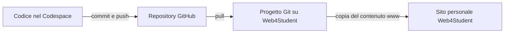

# Esercizio 03: sviluppare il sito con GitHub Codespaces

## Obiettivo

Aprire in Codespaces il repository personale creato nell'esercizio precedente,
eseguire la sua cartella `www`, modificare Hello World e riportare il risultato
su GitHub e Web4Student.

Riferimento teorico:
[Sviluppo online con GitHub e Codespaces](../07-sviluppo_online_con_github_e_codespaces.md).

La teoria descrive anche la configurazione del repository completo del corso,
che usa Docker Compose e un servizio MySQL. Qui lavoriamo sul tuo repository
`sito-php-studente`: per Hello World bastano PHP e la porta 8000, senza database.

## Prerequisiti

- Aver completato [Git e GitHub per l'intera www](02_Git_e_GitHub.md).
- Avere il repository personale su GitHub con `www/01-hello-world/index.php`.
- Poter creare un Codespace con il proprio account o con l'organizzazione del corso.

Non creare un altro repository per il singolo Hello World: prosegui con quello
che contiene l'intero sito.

## Passo 1 — Aggiungere la configurazione PHP al progetto

**Dove:** terminale SSH su Web4Student, nella copia di lavoro dell'esercizio 02.

```bash
cd ~/progetti/sito-php-studente
git status
mkdir -p .devcontainer
nano .devcontainer/devcontainer.json
```

Prima completa eventuali modifiche ancora aperte. Se esiste già una
configurazione del progetto, leggila e adattala invece di sovrascriverla.
Per il nuovo progetto di questa esercitazione inserisci:

```json
{
  "name": "Sito PHP dello studente",
  "image": "mcr.microsoft.com/devcontainers/php:1-8.3-bookworm",
  "forwardPorts": [8000],
  "portsAttributes": {
    "8000": {
      "label": "Sito PHP",
      "onAutoForward": "openBrowser"
    }
  },
  "postStartCommand": "nohup php -S 0.0.0.0:8000 -t \"${containerWorkspaceFolder}/www\" > /tmp/php-course-server.log 2>&1 < /dev/null &",
  "remoteUser": "vscode"
}
```

La struttura ora comprende:

```text
sito-php-studente/
├── .devcontainer/
│   └── devcontainer.json
├── .gitignore
├── README.md
└── www/
    └── 01-hello-world/
        └── index.php
```

| Impostazione | Significato |
|---|---|
| `image` | Ambiente con PHP 8.3 |
| `forwardPorts` | Porta da rendere raggiungibile tramite l'inoltro Codespaces |
| `postStartCommand` | Avvia il server PHP usando `www` come cartella pubblica |
| `${containerWorkspaceFolder}` | Percorso del repository nel container, sostituito da Dev Containers |
| `/tmp/php-course-server.log` | Log del server avviato automaticamente |

Per le opzioni generali consulta la [configurazione PHP per Codespaces](https://docs.github.com/en/codespaces/setting-up-your-project-for-codespaces/adding-a-dev-container-configuration/setting-up-your-php-project-for-codespaces).

## Passo 2 — Inviare la configurazione a GitHub

Sempre dalla radice del progetto su Web4Student:

```bash
git diff
git add -- .devcontainer/devcontainer.json
git diff --cached
git commit -m "Configura Codespaces per il sito PHP"
git push
```

**Verifica nel browser GitHub:** sul ramo `main` compare il file
`.devcontainer/devcontainer.json` accanto alla cartella `www`.
La configurazione deve arrivare nel repository prima di creare il Codespace.

## Passo 3 — Creare il Codespace

**Dove:** browser, nel tuo repository GitHub `sito-php-studente`.

1. Seleziona il ramo `main` aggiornato.
2. Apri **Code → Codespaces**.
3. Scegli **Create codespace on main**.
4. Attendi la preparazione dell'ambiente e l'apertura dell'editor.

Se hai già un Codespace precedente alla configurazione, esegui
**Codespaces: Rebuild Container** dal pannello dei comandi per applicarla.
La [guida introduttiva ufficiale](https://docs.github.com/en/codespaces/quickstart)
mostra il flusso di creazione.

**Verifica:** nell'esplora file vedi `.devcontainer`, `README.md` e tutta `www`.
Il terminale appartiene ora al container remoto di Codespaces, non alla sessione
SSH Web4Student e non al computer locale.

## Passo 4 — Verificare PHP e la cartella di lavoro

**Dove:** terminale integrato del Codespace, nella radice del repository.

```bash
pwd
php --version
php --ini
php -l www/01-hello-world/index.php
git status
```

Controlla che la versione sia PHP 8.3, che il file venga trovato e che il
controllo di sintassi non segnali errori. Il percorso del workspace viene
scelto dall'ambiente: non usare `~/progetti/sito-php-studente` come se fossi
ancora su Web4Student.

## Passo 5 — Aprire Hello World tramite la porta 8000

1. Apri il pannello **Ports** nell'editor.
2. Individua la porta **8000**, etichettata **Sito PHP**.
3. Usa **Open in Browser**.
4. Aggiungi `/01-hello-world/` all'URL inoltrato, mantenendo il dominio assegnato dal tuo Codespace.

Il messaggio iniziale deve essere quello già salvato nell'esercizio 02:
**Hello World sotto controllo versione con Git.**

Il server ascolta nel container; l'URL inoltrato lo rende raggiungibile dal
browser del tuo computer. Non usare il `localhost` del computer per cercare
un processo che gira soltanto nel Codespace. La porta può restare privata.
Vedi la [guida all'inoltro delle porte](https://docs.github.com/en/codespaces/developing-in-a-codespace/forwarding-ports-in-your-codespace).

Se manca la porta, controlla il log:

```bash
tail -n 30 /tmp/php-course-server.log
```

Se il server non è già in esecuzione, puoi avviarlo dal terminale:

```bash
php -S 0.0.0.0:8000 -t www
```

Se compare un errore di porta occupata, non avviare altre istanze: verifica
il servizio partito automaticamente e l'indirizzo inoltrato nel pannello Ports.
L'assenza di un `index.php` nella radice `www` non impedisce di aprire direttamente
il percorso `/01-hello-world/`.

## Passo 6 — Modificare il sito dal browser

Nell'editor del Codespace apri `www/01-hello-world/index.php` e imposta:

```php
$messaggio = 'Pagina aggiornata da GitHub Codespaces.';
```

Salva, controlla la sintassi e ricarica la pagina inoltrata:

```bash
php -l www/01-hello-world/index.php
git diff -- www/01-hello-world/index.php
```

**Verifica:** la pagina mostra il nuovo messaggio e il diff identifica la riga
modificata. Il codice continua a essere eseguito sul server remoto.

## Passo 7 — Fare commit e push dal Codespace

Dal terminale del Codespace:

```bash
git add -- www/01-hello-world/index.php
git diff --cached
git commit -m "Aggiorna Hello World da Codespaces"
git push
git status
git log --oneline -3
```

Il repository è tuo e deve consentire il push. Se viene richiesta l'identità
Git, imposta `git config user.name "Nome Cognome"` e
`git config user.email "tua.email@example.com"` per questa copia, poi ripeti
il commit. Non occorre copiare la chiave privata Web4Student nel Codespace.

**Nel browser GitHub:** apri il repository, controlla l'ultimo commit e verifica
il nuovo messaggio nel file. Salvare nell'editor, fare commit e fare push sono
tre passaggi distinti.

## Passo 8 — Riportare la modifica su Web4Student

**Dove:** terminale SSH Web4Student, non terminale del Codespace.

```bash
cd ~/progetti/sito-php-studente
git status --short
```

L'output deve essere vuoto. Se hai modifiche locali, completale e sincronizzale
prima di procedere, evitando di sovrascriverle. Ricevi poi i commit e aggiorna
la copia pubblicata:

```bash
git pull --ff-only
cp -a www/. ~/www/
```

Riapri `https://w4s.filippobilardo.it/~username/01-hello-world/`.
Deve comparire **Pagina aggiornata da GitHub Codespaces.**, come nell'anteprima
del Codespace. Il testo descrive la modifica al sorgente e può comparire anche
quando la pagina viene eseguita da Web4Student.



## Passo 9 — Concludere la sessione

Verifica che il push sia arrivato su GitHub, poi ferma il Codespace dalla
pagina di gestione dei tuoi Codespaces. Chiudere soltanto la scheda del browser
non equivale a richiedere l'arresto dell'ambiente.

I file non inviati restano legati alla copia di lavoro; eliminare il Codespace
può far perdere modifiche non salvate altrove. Controlla risorse e condizioni
del tuo account e il [ciclo di vita Codespaces](https://docs.github.com/en/codespaces/about-codespaces/understanding-the-codespace-lifecycle).

## Consegna e autovalutazione

Consegna URL del repository, identificativi del commit di configurazione e
del commit da Codespaces, URL personale Web4Student e una breve descrizione
della prova sulla porta 8000. Documenta l'anteprima con uno screenshot se
richiesto dal docente, senza rendere pubblica la porta per la sola consegna.

Rispondi:

1. Perché `www` resta una sottocartella del repository?
2. Che differenza c'è tra terminale del Codespace e terminale SSH Web4Student?
3. Quale comando avvia il server e quale configurazione lo rende automatico?
4. Perché il push da Codespaces non aggiorna da solo la pagina Web4Student?
5. Perché GitHub Pages non sostituisce il server PHP di questa attività?

---

[Esercizio precedente: Git e GitHub](02_Git_e_GitHub.md) · [Indice degli esercizi](README.md) · [Guida teorica](../07-sviluppo_online_con_github_e_codespaces.md)
