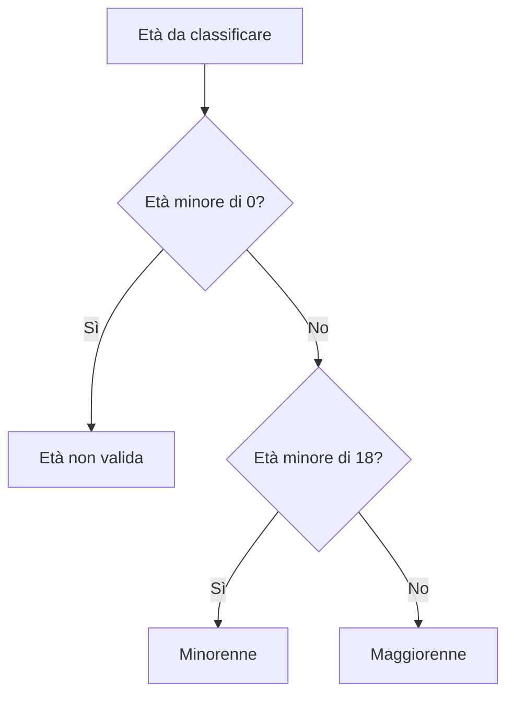

# If, elseif ed else

`if` esegue un blocco quando la condizione è vera. `elseif` verifica un'alternativa
se i rami precedenti non sono stati scelti; `else` gestisce il caso restante.
L'ordine dei controlli conta: viene eseguito soltanto il primo ramo soddisfatto.

```php
if ($voto >= 6) {
    echo 'Sufficiente';
} else {
    echo 'Da recuperare';
}
```

## Condizioni leggibili

La condizione può combinare confronti con `&&`, `||` e `!`. Mantieni le parentesi
che chiariscono il significato. Distingui l'assegnazione `=` dal confronto
`===`, e controlla i dati prima di applicare le regole.

Un `if` annidato è utile quando il secondo controllo ha senso soltanto dopo
il primo. Evita annidamenti inutili: una sequenza ordinata di rami spesso è
più semplice da seguire. Usa le graffe anche per blocchi di una sola istruzione.

## Una richiesta, un'esecuzione

Nel backend la scelta viene fatta quando PHP elabora la richiesta. Cambiare
un valore nel browser senza inviare una nuova richiesta non riesegue il blocco PHP.

Il percorso dell'esempio seguente è:



Riferimenti: [if](https://www.php.net/manual/en/control-structures.if.php), [elseif](https://www.php.net/manual/en/control-structures.elseif.php).

## Esempio completo

```php
<?php
declare(strict_types=1);

foreach ([-1, 0, 17, 18] as $eta) {
    if ($eta < 0) {
        $fascia = 'età non valida';
    } elseif ($eta < 18) {
        $fascia = 'minorenne';
    } else {
        $fascia = 'maggiorenne';
    }

    echo $eta, ': ', $fascia, PHP_EOL;
}
```

Output atteso:

```text
-1: età non valida
0: minorenne
17: minorenne
18: maggiorenne
```

[Sorgente eseguibile](../../../www/03-sintassi-e-costrutti-di-base/esempi/03_Strutture_Condizionali/01_If_Else.php). Nel catalogo web scegli **Strutture condizionali → If, elseif ed else**.

## Prova tu

Classifica un voto da 0 a 10 e tratta come non validi i valori fuori intervallo. Prova almeno -1, 0, 5, 6, 10 e 11.

---

[Indice della sezione](README.md) · [Esercizi](esercizi/README.md) · [Guida successiva](02_Switch.md)
