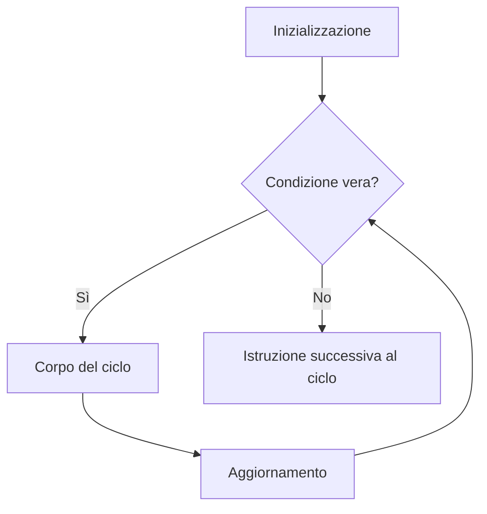

# Cicli for, while e do-while

Un ciclo ripete istruzioni finché una condizione permette di continuare.
Scegli il costrutto in base a ciò che sai prima dell'esecuzione.

| Ciclo | Controllo | Uso tipico |
|---|---|---|
| `for` | Prima di ogni iterazione | Contatore con inizio, limite e passo |
| `while` | Prima di ogni iterazione | Ripetizione governata da una condizione |
| `do ... while` | Dopo ogni iterazione | Corpo da eseguire almeno una volta |

## Le tre parti del for

`for ($i = 0; $i < 3; $i++)` inizializza il contatore una volta, verifica la
condizione prima del corpo e aggiorna il contatore dopo ogni iterazione.
Con indici da zero, `< $numeroElementi` evita di includere un indice oltre il limite.

## Terminazione

Nel ciclo `for` il controllo precede sempre il corpo:



In un `while`, il corpo deve aggiornare i dati che rendono falsa la condizione,
oppure prevedere un'uscita esplicita. Controlla il caso di zero iterazioni.
`do-while` termina con `;` dopo la condizione e compie sempre la prima iterazione.

Il corpo PHP si esegue sul server: stampare mille righe non crea mille richieste
dal browser, ma aumenta il lavoro e la dimensione della risposta.

Riferimenti: [for](https://www.php.net/manual/en/control-structures.for.php), [while](https://www.php.net/manual/en/control-structures.while.php), [do-while](https://www.php.net/manual/en/control-structures.do.while.php).

## Esempio completo

```php
<?php
declare(strict_types=1);

$numeri = [];
for ($i = 1; $i <= 3; $i++) {
    $numeri[] = $i;
}
echo 'For: ', implode(', ', $numeri), PHP_EOL;

$contatore = 3;
$discesa = [];
while ($contatore > 0) {
    $discesa[] = $contatore;
    $contatore--;
}
echo 'While: ', implode(', ', $discesa), PHP_EOL;

$esecuzioni = 0;
do {
    $esecuzioni++;
} while (false);
echo 'Do-while: ', $esecuzioni, PHP_EOL;
```

Output atteso:

```text
For: 1, 2, 3
While: 3, 2, 1
Do-while: 1
```

[Sorgente eseguibile](../../../www/03-sintassi-e-costrutti-di-base/esempi/04_Cicli_Iterazioni/01_Cicli_Base.php). Nel catalogo web scegli **Cicli e iterazioni → Cicli for, while e do-while**.

## Prova tu

Genera i numeri pari da 2 a 10 con for e while. Ripeti l'esperimento con un limite iniziale che non consenta alcuna iterazione.

---

[Indice della sezione](README.md) · [Esercizi](esercizi/README.md) · [Guida successiva](02_Foreach_Array_e_Oggetti.md)
